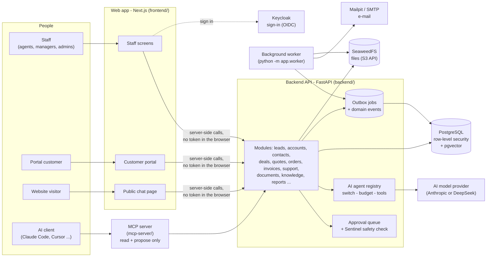
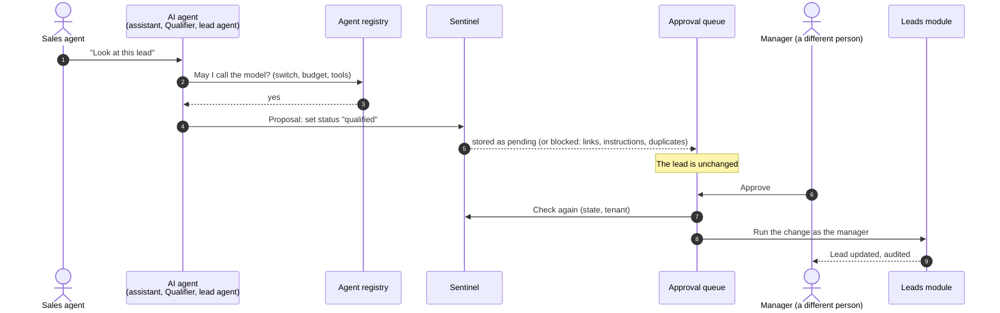

# crm-lead

A CRM for real-estate sales teams: leads from a website chat, qualification, deals, quotes, orders,
invoices, support and a customer portal. AI agents can *suggest* changes, but every change waits
for a person to approve it. It is built as a **modular monolith** (one backend made of modules
with strict borders) and runs on one Windows PC with Docker Desktop.

## Live demo

> **Not online yet.** Nothing in this project is deployed: the owner decides when it goes live,
> and only after the hardening checklist in [docs/deployment.md](docs/deployment.md) is done
> (ADR 0007 or the one-server path of ADR 0021). The link will be added here on that day.
> Until then, run it on your own PC: see [Run it on your PC](#run-it-on-your-pc).
>
> **Demo video:** [Watch the 5-minute demo](https://drive.google.com/file/d/1hHTwIGowlo605uB4ZMZQ_OpmHmuo3k1c/view?usp=drive_link) (fictional data, scripted AI model). Script: [docs/demo-video-script.md](docs/demo-video-script.md).

## How it fits together



**How an AI suggestion becomes a change** - an agent never changes a record itself:



Read [architecture.md](architecture.md) for the full design and [docs/adr/](docs/adr/) for why each
big decision was made.

## What it does

| Area | What is there | Read more |
|---|---|---|
| Leads | Capture, scoring, assignment, property wishes (type, budget in ₹, location), duplicates | [docs/leads.md](docs/leads.md) |
| Website chat | Public chat page that saves a lead; daily counts for the pilot report | [docs/public-chat.md](docs/public-chat.md) |
| AI agents | Staff assistant, Qualifier, optional lead agent; registry with switch and budget; approval queue; Sentinel | [docs/agents.md](docs/agents.md), [docs/approvals.md](docs/approvals.md) |
| Knowledge | Documents with cited answers; RERA numbers and prices only when a cited brochure contains them | [docs/rag-knowledge-base.md](docs/rag-knowledge-base.md), [docs/brochures-rera.md](docs/brochures-rera.md) |
| Sales | Accounts, contacts, pipeline board, activities and tasks, products, quotes with approval, orders, invoices, contracts | [docs/pipeline-activities.md](docs/pipeline-activities.md), [docs/quotes-catalog.md](docs/quotes-catalog.md) |
| Customers | Portal (accounts, orders, invoices, tickets, documents, help), support tickets | [docs/support.md](docs/support.md) |
| Communication | E-mail templates, sending and logging, notifications, automation rules | [docs/communications.md](docs/communications.md), [docs/workflows.md](docs/workflows.md) |
| Insight | Role dashboards, reports with CSV export, AI cost per agent | [docs/dashboard.md](docs/dashboard.md), [docs/reports.md](docs/reports.md) |
| Web check | Looks up a RERA number or company on an allowed public registry and keeps the evidence | [docs/webcheck.md](docs/webcheck.md) |

## Security in one paragraph

Every table that belongs to an organisation has a `tenant_id`, and PostgreSQL **row-level
security** is forced on all of them, so one organisation can never read another's rows, even if
the application code had a bug. Sign-in is handled by Keycloak; the web app keeps tokens in an
encrypted server-side cookie, never in the browser's storage. Every endpoint checks a permission
**and** the record's own rules, and returns "not found" for records you may not see. Details:
[docs/auth.md](docs/auth.md), [docs/rls-audit.md](docs/rls-audit.md),
[docs/injection-defences.md](docs/injection-defences.md).

## Technology

Next.js 16 · React 19 · TypeScript · Tailwind CSS 4 · Python 3.12 · FastAPI · SQLAlchemy 2 ·
Alembic · PostgreSQL 16 + pgvector · Keycloak · SeaweedFS · Mailpit · LangGraph (lead agent only) ·
pytest · Vitest · Playwright · Docker Desktop

## Repository layout

| Folder | What it holds |
|---|---|
| `backend/` | FastAPI app (`app/modules/<module>/`), Alembic migrations, tests, scripts, evaluation cases |
| `frontend/` | Next.js web app, component tests (Vitest), browser journeys (Playwright, `e2e/`) |
| `mcp-server/` | Read-and-propose MCP server for AI clients ([docs/mcp-clients.md](docs/mcp-clients.md)) |
| `infrastructure/` | Docker Compose for PostgreSQL, Keycloak, Mailpit, SeaweedFS and monitoring |
| `deploy/one-host/` | The one-server production setup (not used yet) |
| `docs/` | Guides per feature, ADRs, API contract (`docs/api/openapi.json`) |

## Run it on your PC

Windows CMD. You need Git, **Docker Desktop (running)**, [uv](https://docs.astral.sh/uv/) and
Node.js 22 LTS. Each step is explained in more detail in the linked guide.

**1. Infrastructure** (once: copy the settings and replace every `change-me` with a long random
password):

```bat
cd infrastructure
copy .env.example .env
docker compose up -d
docker compose ps
```

| Service | Address (this PC only) |
|---|---|
| PostgreSQL | `127.0.0.1:5432` |
| Keycloak sign-in | http://localhost:9080 |
| Mailpit (local e-mail inbox) | http://localhost:8025 |
| SeaweedFS (files, S3 API) | `127.0.0.1:9333` by default (`FILES_S3_PORT` in `infrastructure\.env`) |

**2. Backend API** (the first four lines once):

```bat
cd backend
uv venv --python 3.12 .venv
.venv\Scripts\activate
uv pip install -r requirements-dev.txt
copy .env.example .env
alembic upgrade head
python -m scripts.seed_dev_data
uvicorn app.main:create_app --factory --reload
```

Fill in `backend\.env` as its comments say before `alembic upgrade head`. Check
http://127.0.0.1:8000/api/v1/health. Optional fictional content:
`python -m scripts.seed_knowledge_demo` and `python -m scripts.seed_brochures_demo`. The
background worker runs in its own CMD window: `python -m app.worker`.

**3. Web app:**

```bat
cd frontend
copy .env.example .env.local
npm install
npm run dev
```

Open http://localhost:3000 and sign in with a test identity from [docs/auth.md](docs/auth.md).
Guide: [docs/frontend.md](docs/frontend.md). The AI features need a provider key in
`backend\.env` (`CRM_AI_PROVIDER`); `CRM_AI_PROVIDER=fake` gives scripted answers for trying the
screens without a paid key.

## Tests

| What | Command (Windows CMD) |
|---|---|
| Backend tests (real PostgreSQL) | `cd backend && pytest` |
| Backend lint, format, types, module borders | `ruff check . && ruff format --check . && mypy app tests && lint-imports` |
| AI agent evaluation cases (no paid key) | `python -m scripts.eval_agents --provider fake` (in `backend`) |
| Web component tests | `cd frontend && npm test` |
| Web lint and types | `npm run lint && npm run typecheck` |
| Browser journeys (needs the API and web app running) | `npm run test:e2e` |

## Documentation

| File | What it contains |
|---|---|
| [architecture.md](architecture.md) | Design: stack, modules, tenancy, security, folder layout |
| [implementation-plan.md](implementation-plan.md) | Phases and their acceptance criteria |
| [CLAUDE.md](CLAUDE.md) | Project rules, commands and current status |
| [docs/adr/](docs/adr/) | Architecture Decision Records |
| [docs/master-plan.md](docs/master-plan.md) | The order of the remaining work |
| [docs/deployment.md](docs/deployment.md) | How it will go online, and the checklist before it does |
| [docs/inventory.md](docs/inventory.md) | Generated counts: API operations, tables, screens, tests |

## Security notes

- Never commit `.env` files. Copy the matching `.env.example` and fill in local values.
- All demo data (people, leads, brochures, RERA numbers) is fictional.
- Nothing in this project is deployed to the cloud yet.
